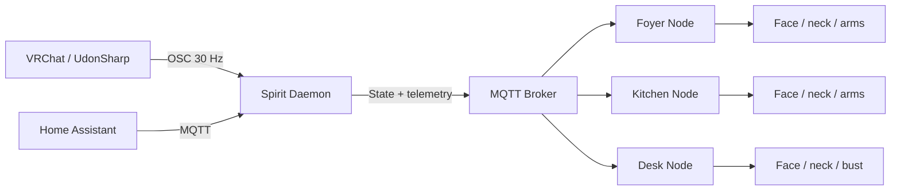

# Distributed Animatronic Android Network

This repository contains a safety-led design package and executable protocol
safety slice for a life-size,
3D-printed maid-robot network. One central digital identity controls multiple
physical nodes, while each node performs only the actuators and sensors required
for its station.

It also contains a separate Rust worldbuilding toolkit under
`projects/loporia-koretoretos/`. Its influence and lore model is fictional
narrative software; it does not control actuators or assign possession leases.

This is a **human-scale, motorized, electrical system**. It is not a toy.
Read [Safety](docs/00-safety.md) before buying parts or energizing hardware.

## Project status

- Concept and system architecture: complete
- Detailed interface specifications: complete
- Parametric CAD: scaffolded
- Firmware: protocol stubs
- Physical prototype: not yet built

## Repository layout

```text
docs/                     Requirements, architecture, BOM, assembly, safety
hardware/
  mechanical/             Parametric CAD and 3D-print specifications
  electrical/             Wiring, schematics, power, EMC, and connector plans
  nodes/                  Foyer, kitchen, and desk node specifications
firmware/
  esp32-s3-head/          Head node MCU firmware
  node-controller/        Shared node actuator controller
  protocol/               Binary packet and command definitions
software/
  spirit-daemon/          Central telemetry bridge
  vrchat/                 UdonSharp animation export
  simulator/              Offline actuator and network simulator
config/                   MQTT, calibration, and node configuration examples
tools/                    Validation and mesh/CAD utilities
tests/                    Protocol, safety, and hardware-in-the-loop tests
```

## System overview



The **spirit daemon** is the authority for safety, node possession, telemetry
limits, and state handoff. Physical nodes never execute a target position
without a valid possession lease or a safe local state.

## Design goals

| Goal | Target |
| --- | --- |
| Head and facial parts | 1:1, adult life-size proportions |
| Animation transport | 30 Hz nominal, 10 Hz minimum |
| Safe actuator slew | Configured per joint |
| Node fail-safe | Disable motion and enter sleep pose on lease loss |
| Server decoupling | Every physical node has an autonomous local controller |
| Mechanical responsibility | Bowden tendons remove large head loads |
| Power isolation | Brains, logic, and actuators have separate regulated rails |
| 3D printing | Standard 220 mm class build volume; indexed subassemblies |

## Getting started

1. Read [requirements](docs/01-requirements.md).
2. Complete the [BOM and procurement plan](docs/04-bom.md).
3. Prototype the head and a single bench node before life-size assembly.
4. Configure MQTT and calibrate actuators with the [commissioning guide](docs/09-commissioning.md).
5. Run simulator and protocol tests before enabling real actuators.

## Licensing

Repository software and documentation remain under the GPL-3.0 license in
`LICENSE`. Printed mechanical designs should receive the same license unless
an explicitly compatible license is added to individual generated assets.
