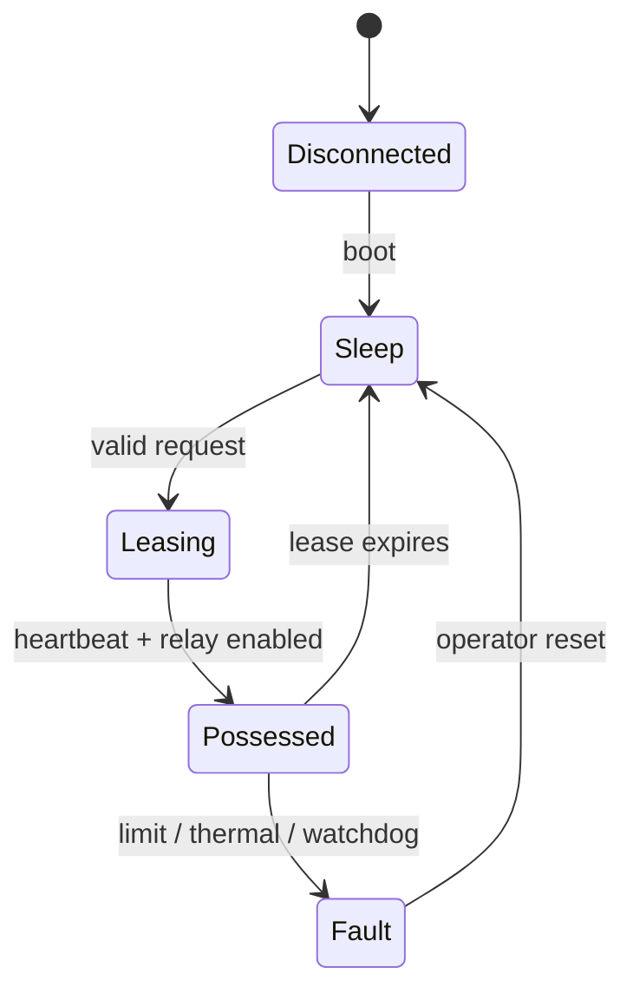

# System Architecture

## Components

### Digital twin

VRChat/UdonSharp maintains the visual pose, gaze, and animation state. It emits
normalized values only; it never sends PWM values or physical node addresses.
It is an optional animation source, not a safety authority: the standalone
daemon can enter sleep mode without VRChat connectivity.

### Spirit daemon

The daemon:

1. Receives OSC/telemetry from UdonSharp.
2. Converts bone and blendshape names to a canonical pose.
3. Enforces per-node and global joint limits.
4. Manages possession leases through MQTT.
5. Publishes nodes at a fixed 30 Hz.
6. Detects loss of Udon data and enters a safe state.

### MQTT broker

MQTT routes state and commands. Broker retained state is not trusted for motion.
Every motion packet requires a monotonic sequence and lease ID.

### Physical node

The node controller converts normalized poses to calibrated actuator targets,
applies rate limits, detects faults, and drives relay and PWM outputs.

## State machines

## Ownership handoff

1. Daemon requests inactive target node.
2. Target acknowledges lease and enters standby.
3. Daemon revokes lease on source node.
4. Target enables actuator power.
5. Pose is ramped over 500-1000 ms.
6. Source enters sleep pose and removes actuator power.

There is no direct peer-to-peer motion transfer. The daemon is the only motion
authority.
